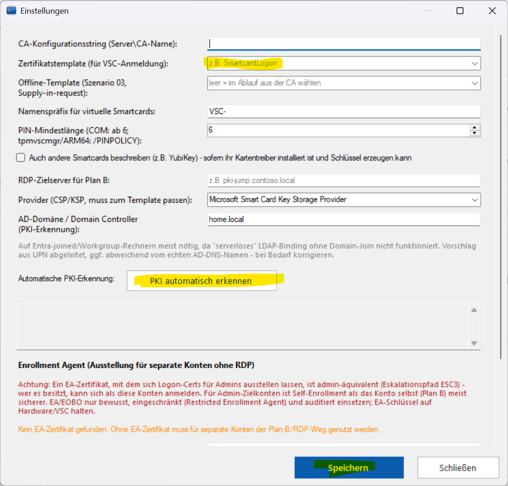

# VSC-Wizard

> **Runbook:** Handlungsanleitungen pro Szenario (Bootstrap, Verlängerung,
> Cloud-GA, EOBO, Server-Core-Submit, Single-Exe-Packaging) stehen in
> [RUNBOOK.md](RUNBOOK.md).

Ein Wizard-Tool für AD-Administratoren zur Beantragung virtueller Smartcards
(TPM Virtual Smart Card). Führt Schritt für Schritt durch die Erstellung der
Karte und die Zertifikatsbeantragung. Der Ablauf ist als durchgängige
Schrittfolge aufgebaut (Schritt 1: Modus- und Kontowahl, danach die einzelnen
Beantragungsschritte mit "Weiter"/"Zurück") mit einer schrittunabhängigen
Kopfleiste, über die jederzeit die Einstellungen erreichbar sind. Es gibt zwei
Szenarien, die in Schritt 1 gewählt werden:

- **Plan A - Direkte Einreichung**: Von diesem Rechner aus kann mit der eigenen
  Identität direkt bei der Enterprise-CA eingereicht werden. Kartenerstellung
  und Zertifikatsbeantragung laufen in einem durchgehenden, automatisierten
  Ablauf.
- **Plan B - CA-Schritt delegieren**: Direkte Einreichung von hier ist nicht
  möglich. Der CSR wird lokal erzeugt, per RDP-Login als Zielbenutzer auf einen
  CA-nahen Server eingereicht, und das ausgestellte Zertifikat anschließend
  wieder lokal auf der virtuellen Smartcard hinterlegt.

> **Wichtig - das eigentliche Kriterium ist nicht der Domain-Join.** Ob Plan A
> geht, hängt an der *Fähigkeit*, von hier direkt bei der CA einzureichen
> (On-Prem-Kerberos-Ticket + DNS/DC-Locator + CA per RPC erreichbar), nicht am
> Maschinen-Status. Ein domänen-gebundener (DJ) Client kann off-net scheitern;
> ein Entra-joined (EJ) Client mit funktionierendem Cloud Kerberos Trust und
> korrektem On-Prem-DNS kann direkt einreichen. Der Domain-Join dient nur als
> schnelle Vorauswahl; die belastbare Antwort liefert der Button
> **"Direkt-Einreichung prüfen"** in Schritt 1 (siehe unten). Plan B ist im Kern
> nicht "der Entra-Weg", sondern "den CA-Schritt an einen fähigen Kontext
> delegieren" - unabhängig vom Client-Typ.

Die Beantragung läuft im Benutzerkontext, in dem der Wizard gestartet wurde
(nur die Kartenerstellung mit `tpmvscmgr` fordert gezielt eine
UAC-Elevation an) - das gilt unabhängig davon, für wen die Smartcard
gedacht ist, siehe nächster Abschnitt.

In Schritt 1 fragt der Wizard zunächst, **für wen** die Smartcard beantragt
wird (und welcher der beiden Abläufe genutzt wird - anhand des erkannten
Domänen-Status *vorgeschlagen*, per "Direkt-Einreichung prüfen" gemessen
bestätigt, jederzeit frei änderbar):

- **Für mich**: normaler Ablauf, alles im aktuell angemeldeten
  Benutzerkontext.
- **Für ein separates Konto** (z.B. ein Admin-Konto): Kartenerstellung und
  CSR-Erstellung laufen trotzdem ganz normal im eigenen Benutzerkontext -
  die Smartcard-PIN ist kontounabhängig und `certreq` verwaltet offene
  Anträge im Profil des aufrufenden Benutzers, nicht des Zielkontos. Es ist
  also **keine** gesonderte Anmeldung als Zielkonto für VSC/CSR nötig.
  Nur die Einreichung bei der CA muss aus Berechtigungsgründen als
  Zielkonto erfolgen (die CA prüft die Enroll-Berechtigung anhand des
  einreichenden Kontos). Dafür gibt es zwei Wege:
    - **Mit Enrollment-Agent-Zertifikat (empfohlen, ohne RDP)**: Liegt im
      eigenen Zertifikatsspeicher ein EA-Zertifikat, läuft die gesamte
      Ausstellung für das Zielkonto bruchfrei in **Plan A** über *Enroll
      on Behalf Of* - der Antrag wird mit dem EA-Zertifikat co-signiert, die
      CA stellt trotzdem auf das Zielkonto aus. Siehe Abschnitt "Enrollment
      Agent" weiter unten.
    - **Ohne EA-Zertifikat (Fallback)**: **Plan B** führt an der passenden
      Stelle einen RDP-Zwischenschritt ein (Einreichung als Zielkonto),
      unabhängig vom Domänen-Status. Die Übernahme des fertigen
      Zertifikats passiert danach wieder hier im eigenen Konto.
  Für mehrere Admin-Konten wird der Ablauf entsprechend mehrfach durchlaufen
  (je eine eigene virtülle Smartcard pro Konto).

## Schnellstart für Admins

So bringst du den Wizard in Betrieb und verteilst ihn per Intune
(Details: [docs/intune-rollout.md](docs/intune-rollout.md)).

1. **Herunterladen:** `VSC-Wizard-<Version>.zip` aus den
   [Releases](https://github.com/azitc-ac/vsc-wizard/releases) laden.
2. **Entsperren (wichtig):** Windows markiert Downloads aus dem Internet; die EXE
   und das Kernmodul werden sonst blockiert. Am einfachsten **vor** dem Entpacken:
   Rechtsklick auf die ZIP > *Eigenschaften* > **Zulassen** > OK. Oder danach im
   entpackten Ordner:
   ```powershell
   Get-ChildItem -Path C:\Temp\VSC-Wizard -Recurse | Unblock-File
   ```
3. **Entpacken**, z.B. nach `C:\Temp\VSC-Wizard`. EXE, `modules\`,
   `config.psd1` und `version.txt` müssen zusammenbleiben.
4. **Konfigurieren:** `VscWizard.exe` **ohne Parameter** starten. Bei leerer
   Konfiguration öffnen sich die Einstellungen automatisch (sonst über den Knopf
   in der Kopfleiste).
   - **„PKI automatisch erkennen“** klicken: übernimmt die CA und wählt das
     Smartcard-Template automatisch (nur Templates für die Smartcard-Anmeldung,
     bevorzugt solche, auf denen die Benutzer *Registrieren* dürfen; der Provider
     wird passend gesetzt).
   - **Template prüfen (wichtig):** Das Ergebnisfeld nennt die Wahl und die
     weiteren geeigneten Templates; bei Bedarf im Dropdown ein anderes wählen.
   - **Speichern** – schreibt `config.psd1` in diesen Ordner.

   
5. **Installieren:** **`install.bat`** doppelklicken (bzw. `VscWizard.exe -Install`)
   – fragt per UAC nach Adminrechten und meldet am Ende das Ergebnis. Kopiert den Ordner **samt `config.psd1`**
   nach `%ProgramFiles%\VSC-Wizard` und richtet Aufgaben und Startmenü ein. Bei der
   nächsten Anmeldung erscheint der Assistent „Smartcard einrichten“.

   Reihenfolge beachten: erst konfigurieren (Schritt 4), dann installieren – die
   installierte Kopie übernimmt die `config.psd1` aus dem Ordner. In
   `%ProgramFiles%` kann der Wizard ohne Adminrechte nicht speichern.
6. **Verteilen per Intune:** genau diesen Ordner (mit der gespeicherten
   `config.psd1`!) als Win32-App paketieren, Installationsbefehl
   `VscWizard.exe -Install`, Kontext **System**. Ohne `config.psd1` mit CA und
   Template startet der Assistent auf den Ziel-PCs nicht. Erkennung,
   Rückgabecodes und Updates: [docs/intune-rollout.md](docs/intune-rollout.md).

## Voraussetzungen

- Windows 10/11 mit PowerShell 5.1
- TPM (für die Erstellung virtueller Smartcards via `tpmvscmgr.exe`)
- `certreq.exe` (Bestandteil von Windows)
- Für Plan A: direkte Netzwerksicht auf eine Active Directory Certificate
  Services (Enterprise) CA
- Für Plan B: ein per RDP erreichbarer Server mit Sicht auf die CA

Hinweis für Umgebungen, in denen PowerShell 7 (pwsh) als Standard-Terminal
genutzt wird: Wird `VscWizard.bat` aus einer pwsh-Umgebung heraus gestartet
(z.B. Doppelklick aus einem pwsh-Terminal, oder ein Prozess, der pwsh's
Umgebung geerbt hat), steht pwsh's Modulpfad in `$env:PSModulePath` vor dem
nativen Windows-PowerShell-5.1-Pfad. Windows PowerShell 5.1 lädt dann beim
Autoloading eingebauter Module fälschlich die PowerShell-7-Variante. Betroffen
waren `Microsoft.PowerShell.Utility` (ohne `Import-PowerShellDataFile` - die
gespeicherte `config.psd1` wurde dadurch bei jedem Start ignoriert) und
`Microsoft.PowerShell.Security` (die Variante registriert das `Cert:`-Laufwerk
nicht - das Smartcard-Inventar zeigte dadurch trotz vorhandener Zertifikate
nichts an). `VscWizard.Core.psm1` erzwingt deshalb beim Laden explizit die
nativen Module über ihren vollen Pfad (siehe Kommentar dort) - auch im
Kindprozess, der die CNG-Schlüsselinfos ermittelt.

## Verwendung

1. `VscWizard.bat` ausführen (startet `VscWizard.ps1` mit
   `-ExecutionPolicy Bypass` im aktuellen Benutzerkontext).
2. `config.psd1` wird leer ausgeliefert (CA-Konfigurationsstring,
   Zertifikatstemplate und RDP-Zielserver sind org-spezifisch und daher nicht
   vorbefüllt). Solange diese Werte fehlen, öffnet der Wizard beim Start
   automatisch den **Einstellungen**-Dialog (jederzeit über den Knopf in der
   Kopfleiste erreichbar) - dort entweder manuell eintragen oder per "PKI
   automatisch erkennen" befüllen lassen (siehe unten), dann "Speichern".
3. In Schritt 1 Konto und Ablauf (Plan A/Plan B) wählen (Plan wird anhand des
   erkannten Domänen-Status vorausgewählt) und dem Wizard mit "Weiter" folgen.

## Aufbau

- `VscWizard.ps1` - GUI/Wizard-Flow (WinForms): schrittbasierter Ablauf
  (Moduswahl + Plan A/Plan B) mit gemeinsamer "Weiter"/"Zurück"-Navigation und
  einer Kopfleiste, die die Einstellungen als Dialog öffnet
- `modules/VscWizard.Core.psm1` - Nicht-GUI-Logik: Logging, Prozessausführung,
  Erkennung von Domänen-/TPM-Status, Erstellung der virtuellen Smartcard,
  CSR-Erstellung/-Einreichung/-Abschluss über `certreq`
- `modules/VscWizard.CreateHelper.cs` - C#-Quellcode des elevierten
  Erstellungshelfers (COM-Interop + PIN-Dialog); wird zur Laufzeit per
  `csc.exe` zu einer fensterlosen winexe kompiliert, siehe "Ablauf im Detail"
- `helper/VscCreateHelper.csproj` - baut denselben Helfer-Quellcode als native,
  self-contained ARM64-App (`build.ps1`, benötigt .NET 8 SDK nur zur Build-Zeit)
- `config.psd1` - Konfiguration (CA, Template, RDP-Zielserver, etc.)
- `VscWizard.bat` - Launcher
- `VscWizard.Submit.ps1` - eigenständiger Einreichungshelfer für die RDP-Sitzung
  in Plan B, siehe Abschnitt "Einreichungshelfer" unten

## Einreichungshelfer (VscWizard.Submit.ps1)

Kleines, bewusst von `VscWizard.Core.psm1` unabhängiges Begleitwerkzeug für die
RDP-Sitzung in Plan B Schritt 5: nimmt eine per Zwischenablage eingefügte
Zertifikatsanforderung (CSR) als PEM-Text entgegen, reicht sie bei der CA ein
(inkl. eigener automatischer PKI-Erkennung und Pending/Retrieve-Unterstützung)
und gibt das ausgestellte Zertifikat wieder als PEM-Text zurück (via
`certutil -encode`), automatisch in die Zwischenablage kopiert.

Da CSR-Dateien (`certreq -new`) und `certutil -encode`-Ausgaben ohnehin reiner
PEM-Text sind, ist dafür **keine Laufwerksfreigabe oder Dateitransfer** in die
RDP-Sitzung nötig - nur RDP-Zwischenablage (Text). Dazu passend:

- Plan B Schritt 3 ("CSR erstellen") zeigt den CSR-Inhalt zusätzlich zum Dateipfad
  als kopierbaren Text an ("CSR-Text kopieren").
- Plan B Schritt 6 ("Zertifikat abschließen") akzeptiert wahlweise eine
  CER-Datei oder eingefügten CER-Text als Alternative.

Da das Skript keine Abhängigkeiten zum restlichen Projekt hat, kann es im
Zweifel auch als reiner Text per RDP-Zwischenablage in die Zielsitzung kopiert,
dort in eine neue `.ps1`-Datei eingefügt und direkt gestartet werden - ganz
ohne das restliche Projekt mit rüberzukopieren.

## Ablauf im Detail

### Direkt-Einreichung prüfen (fähigkeitsbasierte Planwahl)

Der Button **"Direkt-Einreichung prüfen"** in Schritt 1 misst die tatsächliche
Fähigkeit, von diesem Rechner aus direkt bei der CA einzureichen, und
überschreibt die Heuristik-Vorauswahl mit dem Ergebnis. Die Prüfkette (jeweils
mit Klartext-Begründung, läuft in einem Hintergrund-Job mit ~45 s Timeout):

1. **Join-Kontext** (`dsregcmd /status`, inkl. `OnPremTgt`-Feld) - nur zur Info.
2. **On-Prem-Kerberos-TGT vorhanden?** (`klist`) - die Ground Truth der
   authentifizierbaren AD-Identität. Fehlt es (z.B. EJ-Client ohne
   funktionierendes Cloud Kerberos Trust), kann die CA niemanden autorisieren.
3. **CA-Ziel bestimmbar?** - aus dem konfigurierten CA-String oder per
   AD-Discovery. Scheitert das, ist es meist ein DNS-/DC-Locator-Problem.
4. **CA-Server per DNS auflösbar?** - häufigste EJ-Ursache: der Client nutzt
   nicht den On-Prem-DNS.
5. **`certutil -ping`** (Transport + Authentifizierung zur CA) - der
   entscheidende Test. Erfolg => Plan A möglich.

Ergebnis:
- **Erfolg** => Plan A wird empfohlen/gesetzt. (Ob das Konto für das gewählte
  Template *Enroll-Rechte* hat, zeigt sich erst beim Submit - das prüft `ping`
  bewusst nicht.)
- **Fehlschlag** => Plan B, mit dem *konkreten* Grund (kein Ticket / DNS / RPC),
  statt pauschalem "CA nicht erreichbar". Bessert sich die Lage (z.B. CKT/DNS
  eingerichtet), schaltet die Prüfung automatisch wieder auf "direkt" - ganz
  ohne Domain-Join.

### Plan A (automatisiert)

Für "Für mich" (angemeldeter Benutzer) der Standardweg. Für ein separates
Zielkonto funktioniert Plan A ebenfalls, **sofern ein
Enrollment-Agent-Zertifikat vorliegt** - dann stellt Schritt 3 per Enroll on
Behalf Of direkt für das Zielkonto aus (siehe "Enrollment Agent"). Fehlt das
EA-Zertifikat, weist Schritt 3 auf Plan B (RDP) hin.

1. **Status**: Domänen-Status, TPM-Status und angemeldeter Benutzer werden
   automatisch geprüft.
2. **Virtuelle Smartcard erstellen**: läuft über die COM-API
   (`ITpmVirtualSmartCardManager`) in einem gezielt elevierten Helfer.
   Dessen Quellcode liegt als `modules/VscWizard.CreateHelper.cs` vor und
   wird zur Laufzeit mit dem `csc.exe` des .NET Framework zu einer
   `/target:winexe`-Anwendung kompiliert: eine Fenster-Exe hat **kein
   Konsolenfenster** - es erscheint ausschließlich der echte maskierte
   PIN-Dialog (PIN + Bestätigung; die PIN verlässt den elevierten Prozess
   nie). **Auf ARM64** läuft .NET Framework nur emuliert und kann den
   nativen COM-Proxy nicht laden (`0x800700C1`); dort wird stattdessen der
   im Build erzeugte native Helfer `helper-arm64\VscCreateHelper.exe`
   (derselbe Quellcode als self-contained .NET-win-arm64-App, siehe
   `helper/VscCreateHelper.csproj`) eleviert gestartet - gleicher PIN-Dialog.
   Fehlt er, fällt der Wizard auf `tpmvscmgr.exe` (PIN in der Konsole)
   zurück. Nach der
   Erstellung ermittelt der Wizard den PC/SC-Namen der neuen Karte
   ("Microsoft Virtual Smart Card N") und zeigt ihn an - unter DIESEM Namen
   (nicht dem vergebenen Kartennamen!) erscheint die Karte in
   Windows-Kartenauswahl-Dialogen, z.B. bei der Zertifikatsanforderung.
   Die PIN-Mindestlänge beträgt 6 Zeichen und wird über
   `ITpmVirtualSmartCardManager2::CreateVirtualSmartCardWithPinPolicy` mit
   einer serialisierten PIN-Policy (dokumentiertes MS-TPMVSC-Format
   "PinPolicySerialization": 8 Little-Endian-DWORDs - Reserved=1, minLength,
   maxLength, dann fünf Zeichenklassen-Optionen mit 0=Allow/
   1=RequireAtLeastOne/2=Disallow) durchgesetzt. Steht diese Schnittstelle
   nicht zur Verfügung, fällt der Helfer automatisch auf die Basis-API
   zurück (dann Minimum 8) - der PIN-Dialog zeigt in beiden Fällen die
   tatsächlich geltende Mindestlänge an, da die Verfügbarkeit vor dem
   Dialog geprüft wird.
3. **Zertifikat anfordern**: `certreq -new` (Schlüsselerzeugung auf der
   Smartcard) gefolgt von `certreq -submit` gegen die konfigurierte CA und
   `certreq -accept` zur Übernahme - alles im Benutzerkontext. Erfordert das
   Template eine Genehmigung, kann das Zertifikat später über "Zertifikat
   abrufen" nachträglich abgeholt werden.
4. **Zusammenfassung**: Anzeige des ausgestellten Zertifikats (Subject,
   Thumbprint, Gültigkeit).

### Plan B (mit RDP-Zwischenschritt)

Wird gebraucht, wenn dieser Rechner keine direkte Sicht auf die
Zertifizierungsstelle hat **oder** die Smartcard für ein separates Konto
beantragt wird (dann unabhängig vom Domänen-Status, da die Einreichung
in beiden Fällen woanders/als andere Identität passieren muss).

1. **Status**: Erkannter Domänen-Status (Entra-joined/Workgroup), gewähltes
   Zielkonto (falls "Für ein separates Konto" gewählt wurde) und
   konfigurierter RDP-Zielserver. Die automatische PKI-Erkennung (siehe
   Einstellungen) kann auch für Entra-joined-Rechner mit Cloud Kerberos
   Trust und einer VPN-/Private-Access-Verbindung dazu führen, dass direkter
   PKI-Zugriff besteht - in dem Fall (sofern kein separates Konto involviert
   ist) einfach in Schritt 1 "Plan A" wählen, statt den manuellen RDP-Ablauf zu
   durchlaufen.
2. **Virtuelle Smartcard erstellen**: wie bei Plan A - im eigenen
   Benutzerkontext, unabhängig vom Zielkonto.
3. **CSR erstellen (lokal)**: `certreq -new` erzeugt eine an die Smartcard
   gebundene Zertifikatsanforderung mit dem Zielkonto (oder dem eigenen
   Konto) als Subject; läuft ebenfalls im eigenen Benutzerkontext. Pfad
   kann per Knopfdruck kopiert oder der Ordner geöffnet werden - alternativ
   steht der CSR-Inhalt auch als kopierbarer PEM-Text bereit (für die
   RDP-Zwischenablage, z.B. mit dem Einreichungshelfer, siehe unten).
4. **Übergabe per RDP**: Anleitung mit konkretem Zielserver und dem Konto,
   als das man sich dort anmelden soll (Zielkonto bei separatem Konto, sonst
   das eigene); CSR entweder als Datei (Laufwerksfreigabe) oder als Text
   (RDP-Zwischenablage) rüberbringen.
5. **Antrag einreichen (auf dem Server)**: Auf dem RDP-Zielserver, angemeldet
   als das Konto aus Schritt 4, entweder dieselbe Anwendung im gleichen Modus
   weiter bedienen (CSR-Datei auswählen, Template wählen, einreichen) oder
   den schlankeren Einreichungshelfer `VscWizard.Submit.ps1` nutzen (CSR-Text
   einfügen, einreichen, Ergebnis als Text zurück in die Zwischenablage).
   Das ausgestellte Zertifikat muss zurück auf den Ausgangsrechner - als
   Datei oder als kopierter Text.
6. **Zertifikat abschließen (lokal)**: Zurück auf dem Ausgangsrechner, im
   **eigenen** Benutzerkontext (nicht dem Zielkonto - `certreq` verwaltet den
   offenen Antrag im Profil des Kontos, das die CSR erstellt hat), wird die
   `.cer`-Datei ausgewählt (oder der CER-Text eingefügt) und per
   `certreq -accept` an den bereits auf der
   Smartcard vorhandenen privaten Schlüssel gebunden.

### Einstellungen

Die Einstellungen sind ein über die Kopfleiste (Knopf **"Einstellungen"**)
jederzeit erreichbarer Dialog. Die Eingabefelder liegen in einem scrollbaren
Bereich; die Zeile mit **"Speichern"**/**"Schließen"** ist unten fest verankert
und daher immer sichtbar, unabhängig von der Fenstergröße.

Das **Provider-Feld** (CSP/KSP) ist ein editierbares Dropdown mit den beiden
Standard-Smartcard-Providern und muss zum gewählten Zertifikatstemplate
passen: der Legacy-CSP "Microsoft Base Smart Card Crypto Provider" (CAPI,
Template-Schema V1/V2) oder der CNG-KSP "Microsoft Smart Card Key Storage
Provider" (Template-Schema V3/V4 - empfohlen, sofern keine reine
CAPI-Altanwendung das Zertifikat nutzen muss; für die Smartcard-Anmeldung
selbst sind beide gleichwertig). Die INF-Erzeugung erkennt einen KSP am
Namensbestandteil "Key Storage Provider" und lässt dann die reinen
CAPI-Direktiven (`ProviderType`, `KeySpec`) weg, die ein KSP nicht
akzeptiert.

Szenario **04 "VSCs verwalten"** auf der Startseite öffnet einen
Dialog (Master-Detail: Lesegeräte oben, Zertifikate des ausgewählten
Lesegeräts unten, beide als Listen mit Spalten statt Baumtext) mit allen
auf diesem Rechner erkannten Smartcard-Lesegeräten (inkl. virtueller
TPM-Smartcards, da `tpmvscmgr` selbst keinen "list"-Befehl kennt - die
Erkennung läuft über die PnP-Geräteklasse für Smartcard-Lesegeräte).
Lesegerät auswählen zeigt die zugehörigen Zertifikate aus dem
Benutzer-Zertifikatsspeicher (Subject, Gültigkeit, Thumbprint, Provider). Die
Zuordnung Zertifikat -> Lesegerät erfolgt über den PC/SC-Lesegerätenamen
("Microsoft Virtual Smart Card N"): das Zertifikat meldet ihn über die
NCrypt-Property `SmartCardReader`, das PnP-Lesegerät trägt ihn (über seine
`DEVPKEY_Device_Children`-Kennung) als PcscName - so landet jedes Zertifikat
unter seinem konkreten Lesegerät. Der Scan kann durch den Timeout-Schutz gegen
hängende CNG-Schlüsselzugriffe (verwaiste Verweise auf bereits gelöschte
Karten) einige Sekunden dauern; solange läuft ein Wartecursor.

Zertifikate, die zwar als smartcard-gebunden erkannt, aber keinem vorhandenen
Lesegerät zugeordnet werden konnten (z.B. Verweis auf eine bereits gelöschte
Karte), sowie alle sonstigen Zertifikate mit privatem Schlüssel (zur
Fehlersuche), erscheinen als eigene Sammel-Einträge in der Lesegeräte-Liste -
diese tauchen nur auf, wenn es entsprechende Zertifikate gibt.

**"Ausgewählte Smartcard löschen..."** ruft `tpmvscmgr destroy` für das
ausgewählte Lesegerät auf (nach Sicherheitsabfrage) - unwiderruflich,
alle darauf gespeicherten Schlüssel gehen dabei verloren. Nur für echte
Lesegeräte verfügbar, nicht für die Sammel-Einträge.

Kompaktes Grid-Layout (Label neben statt über dem Feld). Leere Felder zeigen
einen grauen Hinweistext (z.B. `z.B. ca01.contoso.local\Contoso-Issuing-CA`),
der beim Klick ins Feld verschwindet und beim Verlassen eines leeren Feldes
wieder erscheint - er wird nicht als echter Wert gespeichert.

Das **Zertifikatstemplate** ist ein Dropdown (mit manueller Eingabe
kombinierbar) - es wird bewusst nur eines konfiguriert, da eine
VSC-Anmeldung immer genau ein Template verwendet.

Der Button **"PKI automatisch erkennen"** fragt die Enterprise-CAs direkt aus
der AD-Konfigurationspartition ab (LDAP) und testet die RPC-Erreichbarkeit
jeder gefundenen CA (`certutil -ping`, ca. 40 Sekunden Zeitlimit). Bei Erfolg
wird der CA-Konfigurationsstring direkt eingetragen und das
Zertifikatstemplate-Dropdown mit allen auf der CA verfügbaren Templates
befüllt (erstes als Vorschlag vorausgewählt - im Dropdown ggf. das
passende auswählen, z.B. ein "SmartcardLogon"/"SmartcardUser"-artiges
Template statt eines für Verschlüsselung/Webserver/etc.). Anschliessend
noch "Speichern" klicken, um die Werte dauerhaft in `config.psd1` zu
übernehmen.
Schlägt die Erkennung fehl, zeigt das Ergebnisfeld die konkrete Ursache
(LDAP-Fehler, CA gefunden aber per RPC nicht erreichbar, Zeitüberschreitung).

Das Feld **"AD-Domäne oder Domain Controller"** ist für die Discovery
wichtig: .NET versucht ohne diese Angabe ein "serverloses" LDAP-Binding, das
auf lokalen Domain-Join-Informationen beruht. Auf einem domänen-gebundenen
Rechner klappt das von selbst; auf einem **Entra-joined- oder
Workgroup-Rechner fehlt dieser Kontext praktisch immer** - selbst mit
gültigem Kerberos-Ticket (z.B. via Cloud Kerberos Trust) schlägt die
Erkennung dann ab, wenn dieses Feld leer bleibt. Der Wizard schlägt beim
ersten Öffnen der Einstellungen automatisch einen Wert aus der
UPN-Domäne vor (Achtung: kann vom tatsächlichen AD-DNS-Namen abweichen,
falls ein eigener UPN-Suffix konfiguriert ist - im Zweifel einen konkreten
Domain-Controller-Namen eintragen, z.B. `dc01.contoso.local`).

## Manüller Testplan

Da für diese Automatisierung ein echtes Windows-System mit TPM, AD und einer
erreichbaren Zertifizierungsstelle nötig ist, gibt es keine automatisierten
Tests. Vor dem produktiven Einsatz empfiehlt sich folgender manueller Ablauf:

1. **Plan A** auf einem domänen-gebundenen Testrechner mit TPM und
   Netzwerksicht auf eine Test-CA durchspielen (inkl. Ablehnung/Timeout-Fälle
   und einem Template, das eine manuelle Genehmigung erfordert).
2. **Plan B** auf einem Entra-joined- oder Workgroup-Testrechner durchspielen,
   inklusive echtem RDP-Hop auf einen CA-nahen Server als Zielbenutzer -
   einmal mit Datei-Übergabe (Laufwerksfreigabe), einmal rein per
   RDP-Zwischenablage (CSR-Text kopieren -> `VscWizard.Submit.ps1` auf dem
   Server -> CER-Text zurückkopieren -> Schritt 6 per Text abschließen).
3. Fehlerfälle prüfen: falsches Zertifikatstemplate, nicht erreichbare CA,
   abgelehnter UAC-Prompt, TPM nicht bereit.
4. Log-Export im Bereich "Log / Diagnose" (unten im Hauptfenster) prüfen.

## Enrollment Agent (Ausstellung für separate Konten ohne RDP)

Ein Enrollment-Agent-Zertifikat (EKU *Certificate Request Agent*,
`1.3.6.1.4.1.311.20.2.1`) erlaubt es, Zertifikate **im Auftrag anderer
Konten** auszustellen (Enroll on Behalf Of, EOBO). Damit entfällt der
RDP-Bruch für separate Zielkonten komplett: der Antrag wird mit dem
EA-Zertifikat co-signiert, die CA stellt trotzdem auf das Zielkonto aus -
alles in der eigenen Sitzung.

**EA-Zertifikat beantragen** (Einstellungen): Da das EA-Zertifikat auf das
**eigene** Konto ausgestellt wird, ist das eine ganz normale
Direkt-Beantragung (kein RDP). Der Wizard bietet zwei Schutzvarianten für
den mächtigen EA-Schlüssel:
- **Auf eigener VSC (TPM/PIN, Standard/empfohlen)**: der EA-Schlüssel liegt
  auf einer eigenen virtuellen Smartcard - nicht exportierbar,
  PIN-geschützt. Jede EOBO-Ausstellung verlangt dann die PIN (bewusster
  Autorisierungs-Gate).
- **Software-Schlüssel**: CNG-Software-Schlüssel im Benutzerspeicher -
  bequemer, aber portabler/weniger geschützt.

Ist ein EA-Zertifikat vorhanden, erkennt der Wizard es automatisch und
schaltet für separate Konten den bruchfreien Plan-A-Weg frei (Schritt 3
erzeugt dann einen PKCS7-EOBO-Antrag: `certreq -new -cert <EA-Thumbprint>`
mit `RequestType=PKCS7` und `RequesterName=<Zielkonto>`; der Template-Verweis
steht im Antrag, `certreq -submit` reicht ihn ohne `-attrib` ein).

**Voraussetzungen auf der CA-Seite**: Das Ziel-Template muss EOBO erlauben und
die CA muss den Antragsteller als Enrollment Agent akzeptieren; oft ist
"Restricted Enrollment Agents" konfiguriert (schränkt ein, welcher EA für
welche Konten/Templates ausstellen darf). Ein EA-Zertifikat ist
sicherheitskritisch - damit lassen sich Anmelde-Zertifikate für beliebige
Konten ausstellen; die Vergabe sollte der PKI-Policy entsprechen.

## Begonnene Anträge fortsetzen

Der Wizard speichert den Stand eines laufenden Antrags nach jedem Meilenstein
(Plan B: CSR erstellt; Plan A/B: Antrag eingereicht und wartet auf
Genehmigung) als `resume-state.txt` im Arbeitsverzeichnis. Wird der Wizard
geschlossen und später neu gestartet, bietet er das Fortsetzen an und
springt mit wiederhergestelltem Kontext (Kartenname, RequestId, Pfade)
direkt zum passenden Schritt - z.B. um ein inzwischen genehmigtes Zertifikat
über "Zertifikat abrufen" abzuholen. Bei "Nein" wird nur der gespeicherte
Wizard-Stand verworfen; der offene Antrag selbst bleibt im
Zertifikatsspeicher des Benutzers (Windows verwaltet ihn im REQUEST-Store)
und kann notfalls über Schritt "Zertifikat abschließen" mit der
CER-Datei/dem CER-Text weiterhin abgeschlossen werden. Nach erfolgreicher
Übernahme des Zertifikats wird der gespeicherte Stand automatisch
gelöscht.

## Bekannte Einschränkungen (v1)

- Keine granulare Übersetzung von `certreq`-Fehlercodes; Rohausgabe steht im
  Log.
- Der RDP-Zwischenschritt in Plan B bleibt bewusst manuell (Kopieren der
  CSR-/CER-Datei) - dies ist eine inhärente Einschränkung des Szenarios ohne
  direkte CA-Sicht.
- Die automatische Erreichbarkeitsprüfung ist auf ca. 40 Sekunden begrenzt
  (LDAP-Discovery + RPC-Ping je CA); bei einer sehr langsamen, aber
  grundsätzlich erreichbaren PKI kann das fälschlich als "nicht erreichbar"
  gewertet werden.
- Enroll on Behalf Of / EA-Zertifikate: der Ablauf ist implementiert, aber auf
  echter Hardware noch nicht verifiziert; er setzt zudem passende CA-seitige
  EOBO-Konfiguration voraus (siehe "Enrollment Agent"). Ohne EA-Zertifikat
  bleibt für separate Konten der Plan-B/RDP-Weg.
- "Direkt-Einreichung prüfen" beweist über `certutil -ping` Transport +
  Authentifizierung zur CA, aber NICHT die Enroll-Berechtigung auf dem konkreten
  Template - die zeigt sich erst beim eigentlichen Submit. Der Check ist auf
  echter Hardware ebenfalls noch nicht verifiziert.
- Das Löschen virtueller Smartcards läuft weiterhin über `tpmvscmgr destroy`
  statt über die COM-API: `DestroyVirtualSmartCard` lieferte auf der
  Testhardware S_OK, entfernte die Karte aber nicht (Verhalten ungeklärt,
  möglicherweise verzögerte Entfernung) - `tpmvscmgr` verhält sich korrekt.
- Die PIN-Mindestlänge von 6 setzt `ITpmVirtualSmartCardManager2` voraus;
  ohne diese Schnittstelle greift automatisch die Basis-API mit Minimum 8
  (der PIN-Dialog zeigt die jeweils geltende Grenze an).

## Lizenz

MIT – siehe [LICENSE](LICENSE).
